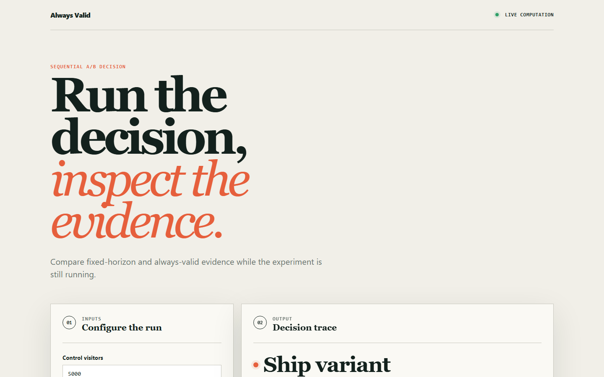
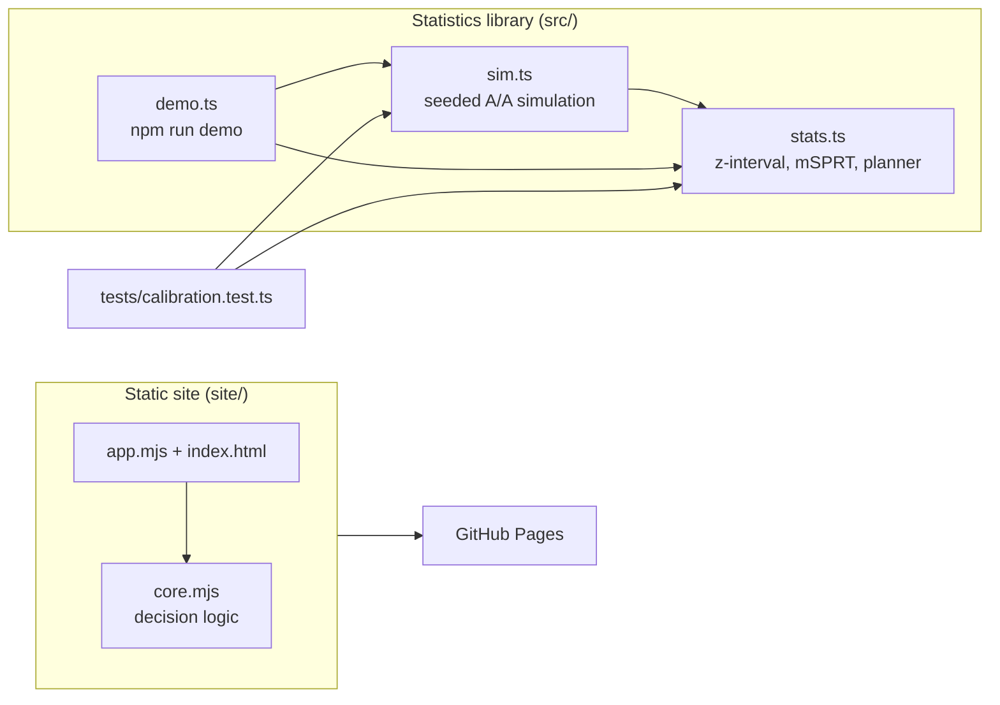

# alwaysvalid

A sequential A/B calculator that ships the A/A simulation showing why peeking at a fixed-horizon test breaks it.

[](https://github.com/ghopgaurav/alwaysvalid/actions/workflows/ci.yml)
[Live demo](https://ghopgaurav.github.io/alwaysvalid/)



## Why

Teams open the experiment dashboard every day and stop the test as soon as it turns green. A fixed-horizon test is only valid when it is evaluated once, at a sample size fixed in advance. Every extra look is another chance for noise to cross the significance line, so the real false-positive rate climbs far above the nominal 5%. Generic calculators implement the z-test and add a warning about peeking that few people read. This project measures the damage with a simulation you can run yourself and implements an alternative that stays valid at every look.

## Features

- Fixed-horizon two-proportion z-interval and an always-valid confidence sequence (normal-mixture mSPRT) for conversion rates, side by side
- Seeded A/A simulation harness that reports empirical false-positive rates for each method, with and without daily peeking
- False-positive-rate-versus-number-of-looks curve
- Power check: detection rate and median stopping day when a real lift exists
- Sample-size and minimum-detectable-effect planner that reports users and days
- A browser calculator (static page, deployed to GitHub Pages) for entering control and variant counts and getting a ship / keep-running decision

## Architecture



`src/stats.ts` holds the inference code, `src/sim.ts` simulates many experiments with a seeded PRNG, and `src/demo.ts` prints the report. The `site/` calculator is a separate, simpler implementation. See [docs/ARCHITECTURE.md](docs/ARCHITECTURE.md) for more.

## Quick start

Requires Node 22.6 or newer (CI uses 24). `npm test` runs both the TypeScript and site tests on every supported Node version. TypeScript runs through Node's type stripping, so there is no install step and no `node_modules`. On Node 22.6 to 22.17, add `--experimental-strip-types` (for example `node --experimental-strip-types src/demo.ts`); Node 22.18+ and 24 need no flag.

```bash
git clone https://github.com/ghopgaurav/alwaysvalid.git
cd alwaysvalid
npm run demo     # print the simulation report
npm test         # run all tests
```

To try the calculator locally, serve the `site/` folder with any static server, for example `python3 -m http.server -d site 8000`, and open http://localhost:8000.

## Usage

`npm run demo` simulates 2,000 A/A experiments (both arms convert at 8%, 2,000 users per day, 21 days) with a fixed seed, so the output reproduces exactly:

```text
  method                  process                     false-positive rate
  fixed-horizon z-test    looked at once, at the end  4.5%
  fixed-horizon z-test    peeked at daily             24.4%   <- what teams do
  always-valid (mSPRT)    peeked at daily             0.3%

  looks     fixed-horizon     always-valid
  1           4.5%  #####                       0.1%
  7          17.6%  ##################          0.4%
  21         24.4%  ########################    0.3%

  With a REAL 15% lift present:
  method                    detected      median day called
  fixed-horizon (peeking)   100%          3
  always-valid              97%           13
```

The same report also prints interval widths at fixed snapshots and a sample-size table (a 2% detectable lift needs about 910,000 users, roughly 456 days at this traffic).

Using the library directly:

```ts
import { alwaysValid, fixedHorizon } from './src/stats.ts';

const control = { n: 10_000, conversions: 800 };
const variant = { n: 10_000, conversions: 880 };
fixedHorizon(control, variant);  // { effect, low, high, significant, method }
alwaysValid(control, variant);   // wider interval, valid at any stopping time
```

For these counts the fixed-horizon interval is `[0.0003, 0.0157]` (significant) while the always-valid interval is `[-0.0064, 0.0224]` (not significant), since the second one is priced for repeated looks.

## How it works

- **Fixed horizon.** `fixedHorizon` computes a normal-approximation interval for the difference in proportions. It is correct when looked at once: the simulation measures 4.5% against a nominal 5%. The process around it is what fails.
- **Always valid.** `alwaysValid` builds a confidence sequence from a mixture sequential probability ratio test with a normal mixture. Its radius carries an extra log term that grows with the sample, so the chance of ever crossing the boundary under the null stays at or below alpha.
- **Conservatism.** The always-valid rate is 0.3%, not 5%: the guarantee is "never more than alpha", not "equal to alpha". The cost is power, with a median detection day of 13 versus 3 for a 15% lift. The peeking z-test looks faster only because some of its early calls are false positives.
- **`tau` must be chosen in advance.** It is the mixture variance and sets the sample size where the sequence is tightest (`DEFAULT_TAU = 1.5e-5`, about two arms of 10,000 at an 8% base rate). Tuning it after seeing data reintroduces the peeking problem.
- **Reproducibility.** `sim.ts` uses a mulberry32 PRNG with a fixed seed.

## Testing

```bash
npm test
```

`tests/calibration.test.ts` runs the A/A simulation and asserts that the always-valid method stays at or below 5% under daily peeking while the fixed-horizon method exceeds 20%, and that the gap is more than 4x, that a single look is calibrated, that the false-positive rate grows with the number of looks for fixed-horizon but not for always-valid, that real effects are detected (with the sample-size cost), interval properties, the planner, and the normal CDF and quantile. `site/core.test.mjs` covers the browser calculator's decision contract. CI also runs `scripts/validate_site.py` to check the page structure.

## Project layout

```text
src/stats.ts     fixed-horizon and always-valid inference, planner
src/sim.ts       seeded A/A simulation and peeking curve
src/demo.ts      report printed by npm run demo
tests/           calibration and numerics tests
site/            static calculator deployed to GitHub Pages
scripts/         site structure validation used by CI
docs/            architecture notes and screenshots
```

## Limitations

- The browser calculator in `site/` is a simplified approximation: it uses a two-sided z-test with the p-value multiplied by the number of planned looks (a Bonferroni-style correction), not the mSPRT in `src/`. Use the library for the real thing.
- Binary conversion metrics only. Continuous metrics, multiple variants and multiple metrics are not supported.
- Simulated data, not an experimentation platform: no assignment, logging or storage.
- Not validated against a production experimentation system.

## License

MIT, see [LICENSE](LICENSE).

## Maintainer

Originally created by Gaurav Ghop and currently maintained by Gaurav Ghop, a software developer with 4+ years of professional experience. For project questions, contact [Gaurav by email](mailto:gauravghopwork@gmail.com) or visit the [GitHub repository](https://github.com/ghopgaurav/alwaysvalid).