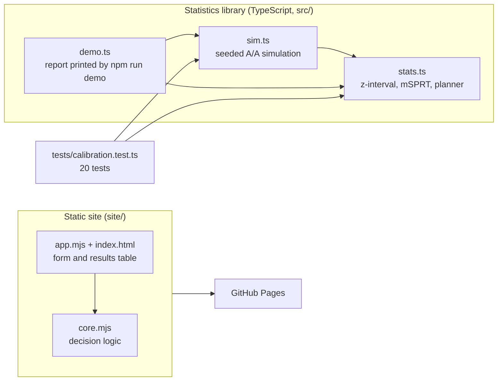

# Architecture

## Context

Experiment dashboards invite peeking: someone opens the results every day and
stops the test the first time it looks significant. A fixed-horizon test is
only valid if it is evaluated once, at a sample size chosen in advance, so
daily peeking inflates the false-positive rate well beyond the nominal 5%.
Always Valid puts the two approaches side by side, measures the damage in a
seeded simulation, and offers an always-valid alternative (a confidence
sequence from a mixture sequential probability ratio test, mSPRT).

## Components

The library has no dependencies and runs on Node's built-in type stripping, so
there is no build step. The static site is a separate, deliberately simpler
calculator (see Limitations in the README); it shares no code with `src/`.

## Key decisions

**Ship the simulation next to the method.** The claim "peeking breaks
fixed-horizon tests" is old and widely ignored. `simulate()` runs experiments
in which both arms are identical, applies a stopping rule at every look, and
reports how often a winner is declared. Seeds are fixed (`mulberry32`), so the
numbers reproduce exactly and the tests can assert on them.

**Mixture confidence sequence with a normal mixture.** The always-valid
interval widens by a log term that grows with the sample size, which pays for
the option to stop at any time. The trade-off is conservatism: the realised
false-positive rate sits well below alpha, and detection is slower (median day
13 versus day 3 for a 15% lift, but the faster peeking z-test includes false
positives).

**`tau` is an explicit parameter.** It is the mixture variance and decides at
which sample size the sequence is tightest. It has to be fixed before the
experiment; tuning it on observed data would reintroduce the peeking problem.
`DEFAULT_TAU = 1.5e-5` corresponds to roughly two arms of 10,000 users at an 8%
base rate.

**No dependencies.** Normal CDF (Abramowitz and Stegun 7.1.26) and quantile
(Acklam) are implemented in `stats.ts` and tested against known values.

## Failure modes

- An arm with fewer than two users returns an unbounded, non-significant
  interval instead of a misleading one.
- Identical arms are never reported as significant.
- Wrong `tau` degrades power, not validity, as long as it is chosen before the
  data are seen.

## Out of scope

Traffic allocation, multiple metrics or variants, variance reduction, and any
experimentation platform concerns (assignment, logging, storage).
